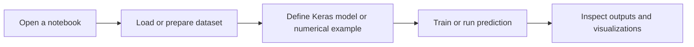

# Deep Learning Lab Programs

**A collection of Jupyter notebooks demonstrating neural network and deep learning workflows.**

## Overview

This repository contains course and experiment notebooks covering supervised prediction, image classification, sequence models, and neural network fundamentals. The examples use TensorFlow/Keras and NumPy with datasets loaded from Keras or, for the face-mask exercise, Kaggle.

## Key topics

- Build and train basic Keras prediction models.
- Explore feed-forward neural networks and activation functions.
- Train image classifiers with MNIST, CIFAR-10, and a face-mask dataset exercise.
- Experiment with SimpleRNN, LSTM, GRU, and encoder-decoder sequence models.
- Inspect model outputs and sample images with Matplotlib.

## Tech stack

Python, Jupyter Notebook, TensorFlow/Keras, NumPy, Matplotlib, Pillow, and Kaggle CLI for the face-mask dataset notebook.

## Architecture and workflow



Each notebook is a standalone lab exercise; there is no shared application or central pipeline.

## Project structure

```text
.
├── DL_Lab4.ipynb
├── RNN_Sequence_Prediction.ipynb
├── Simple_Prediction_Model.ipynb
├── dlLab18_3_26.ipynb
├── dlLabProgramsALL.ipynb
└── dlLab_13_3_26.ipynb
```

## Installation and execution

Create a Python environment, install the notebook and ML libraries, then launch Jupyter:

```bash
python -m venv .venv
# Activate the environment for your shell, then:
python -m pip install jupyter tensorflow numpy matplotlib pillow
jupyter notebook
```

Open a notebook and run its cells from top to bottom. Some examples download data at runtime; the face-mask notebook uses Kaggle CLI and requires Kaggle credentials plus access to the referenced dataset.

## Screenshots and demo

No standalone screenshots or hosted demo are included; the notebooks contain the code and outputs for each exercise.

## Author

**Gireesh Sadanand Patgar** · [GitHub](https://github.com/gireeshpatgar17)
